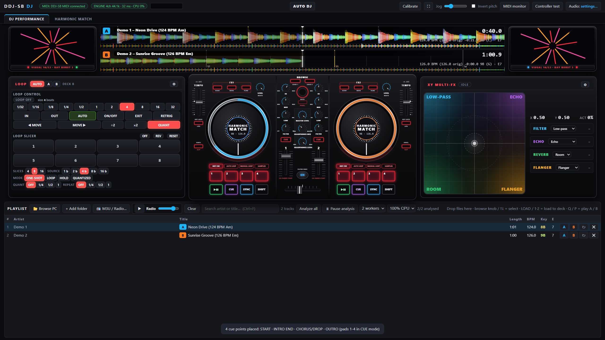
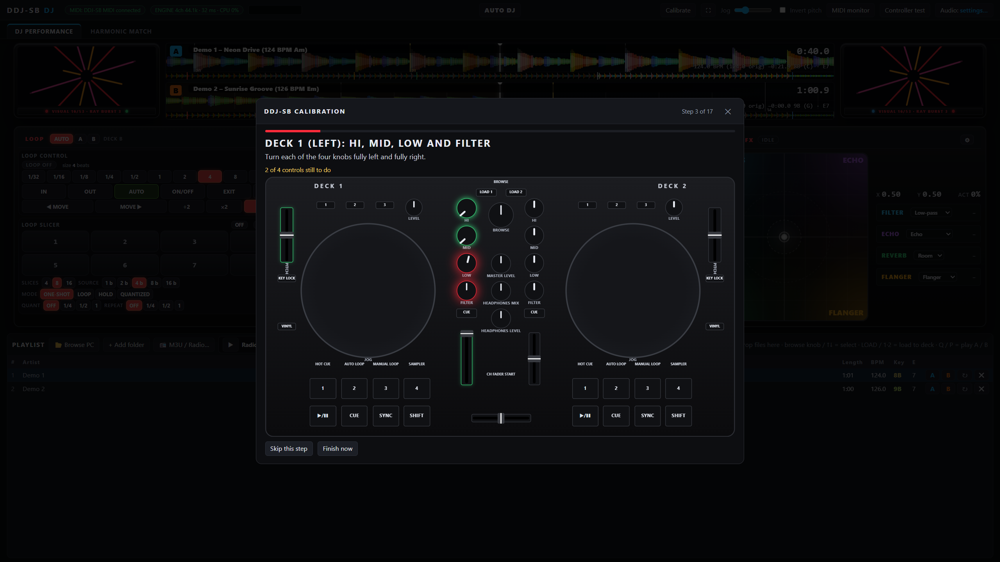
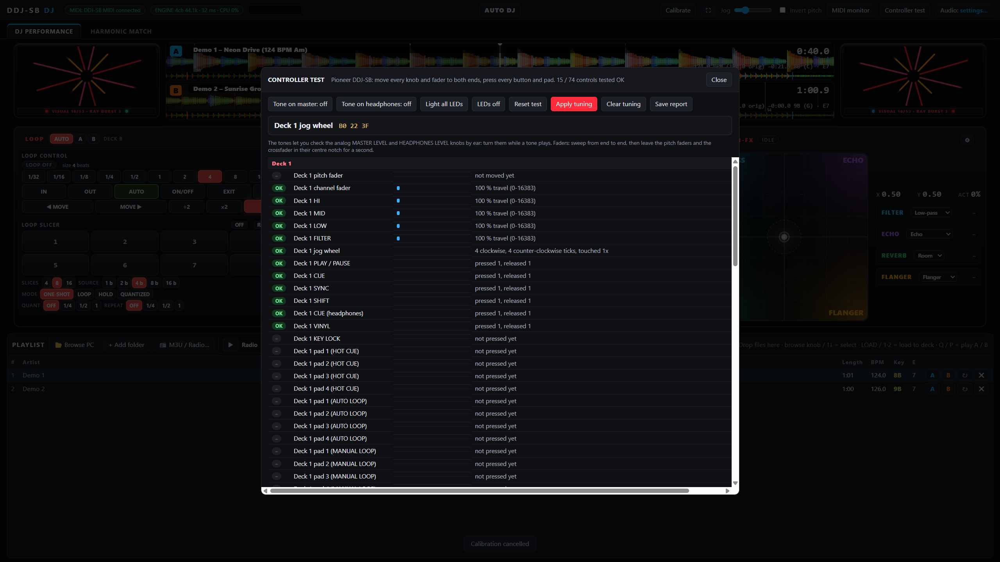

# DDJ-SB DJ: free DJ software for the Pioneer DDJ-SB controller

**DDJ-SB DJ** is free, dedicated DJ software for the **Pioneer DDJ-SB** DJ controller, for **Windows** and **macOS**. Plug the DDJ-SB in, install the driver, and mix: two decks with big scrolling waveforms, automatic beat and key analysis, Harmonic Match track suggestions, Auto DJ, loops, a loop slicer, 36 effects and an XY multi-effect pad, all driven by the controller. It is a free alternative to Serato DJ Intro, rekordbox and Virtual DJ for DDJ-SB owners who want a simple, fast, open program.

> Unofficial project. Pioneer DJ and DDJ-SB are trademarks of their owners; this software is not affiliated with or endorsed by them. Version **0.2.0**, first public release.

## Highlights
- **Made for the DDJ-SB.** The on-screen console is drawn like the controller (jog wheels, tempo faders, HI / MID / LOW / FILTER, FX1 / FX2, performance pads, CUE buttons, FILTER FADE, crossfader), and every control and LED is mapped.
- **First-start calibration wizard.** A window drawn like the controller asks you to move every fader and knob and press every button, records the real travel, the centre notches and the noise, and tunes the software for best performance. Rerun it any time from the **Calibrate** button.
- **Controller test.** Records every one of the 74 controls live (the results are kept when you close the window), plays tones on the master and headphones, lights the LEDs and saves a report.
- **Plug-and-play audio.** Plug the DDJ-SB in while the program runs and the master and headphones move to its outputs by themselves (unless you chose the audio setup by hand); unplug it and the sound falls back to the default output.
- **QUANTIZE.** SHIFT + SYNC snaps cue, hot cue and loop points to the beat grid.
- **Real KEY LOCK (master tempo)**, selectable tempo range (6 / 8 / 10 / 16 / 25 %) and SYNC with beat alignment.
- **Headphone cueing the DJ way.** The headphones play a deck only while its CUE button is on, with the HEADPHONES MIX blend and automatic speaker / headphone time alignment.
- **Effects.** 36 effects on the FX1 / FX2 buttons (right-click a button to choose the effect), FX LEVEL knobs, a per-channel FILTER, an XY multi-effect pad with a selectable effect on every row, and a FILTER FADE button.
- **Library, key and BPM.** Fast analysis of BPM, musical key (Camelot), energy and intro / outro, Harmonic Match suggestions that sort by key, tempo and energy, and **Auto DJ** that mixes the next song for you.
- **Loops and slicer.** Auto loops, manual loops, loop roll, a loop slicer and hot cues with automatic cue points.
- **Visuals.** Reactive visuals, scrolling zoomable waveforms you can click, drag and scroll.
- Free, no account, no cloud. Your music stays on your computer.

## Install
**Windows** (Windows 10 or 11): download `DDJSBDJ-Setup-0.2.0.exe` from [Releases](../../releases), run it and accept the offer to install Pioneer's DDJ-SB driver (Windows needs it to give the controller its MIDI port). A portable `DDJSBDJ-0.2.0-portable.exe` is also provided. Windows may warn about an unknown publisher because the app is not code-signed: **More info, Run anyway**.

**macOS** (12 Monterey or newer, Apple silicon and Intel): download `DDJSBDJ-0.2.0-mac-arm64.dmg` (M1 and later) or `DDJSBDJ-0.2.0-mac-x64.dmg` (Intel), drag the app to Applications, then right-click it and choose **Open** the first time (the app is not signed or notarised by Apple). The DDJ-SB works on macOS without a driver.

The first time the DDJ-SB is detected, the calibration wizard offers to start.

## Controls
| Control | What it does |
|---|---|
| PLAY / PAUSE, CUE, SYNC | transport, cue point, tempo and beat sync |
| SHIFT + PLAY / CUE | restart the track / brake |
| SHIFT + SYNC | QUANTIZE on / off (cue, hot cue and loop points snap to the beat) |
| CUE (under FILTER) | headphone cue for the channel |
| VINYL | scratch mode for the jog wheel |
| KEY LOCK, SHIFT + KEY LOCK | master tempo on / off, tempo range |
| Pitch fader | tempo (top = slower, centre notch = 0) |
| Jog wheel / ring | pitch bend, scratch, search (SHIFT: faster) |
| HI, MID, LOW, FILTER | channel EQ and DJ filter |
| Pads: HOT CUE / AUTO LOOP / MANUAL LOOP / SAMPLER | cue points, loops, loop in / out / exit / halve, effect pads |
| FX1 / FX2 SELECT 1-3, LEVEL | hold an effect, set its amount |
| Crossfader, FILTER FADE | blend decks, sweep the channel filters with the crossfader |
| HEADPHONES MIX | blend cue and master in the headphones |
| SHIFT + HEADPHONES MIX | software HEADPHONES LEVEL |
| SHIFT + FX LEVEL | software MASTER LEVEL |
| BROWSE, LOAD 1 / 2 | move through the playlist, load to a deck |

The controller's own MASTER LEVEL and HEADPHONES LEVEL knobs are analog: they set the DDJ-SB's output level directly and send no MIDI, so software cannot read them. The on-screen knobs and the SHIFT shortcuts above control the software volume.

## Status
The mapping is built from the Mixxx project's DDJ-SB mapping and was tested on a real DDJ-SB (decks, faders, knobs, filters, FX, jog wheels, KEY LOCK, pitch faders, crossfader, browse, headphone cue). Some pads (auto loop and manual loop modes) and a few buttons (LOAD, BACK) are mapped but not yet confirmed on hardware. Not yet mapped: slip, quantize, deck 3 / 4 switching. Please [report problems](../../issues).

## Build from source
Requires Node.js 20+ and Rust. `npm install`, `npm run build:engine` (the audio engine), then `npm start`. `npm run dist` builds the Windows installer, `npm run dist:mac` the macOS images (the GitHub Action **Build macOS installers** does this on a Mac). Architecture notes: [ARCHITECTURE.md](ARCHITECTURE.md).

## Credits and licences
- The DDJ-SB MIDI mapping follows the Mixxx project's mapping by Joan Ardiaca Jove, wingcom and Hilton Rudham (MIT licence). See [NOTICE.md](NOTICE.md).
- The Windows installer bundles Pioneer DJ's own **DDJ-SB driver 1.100** (signed by Pioneer DJ Corporation) for convenience. It is Pioneer's software under Pioneer's licence, shown by its own installer; it is not part of this project's code.

Keywords: Pioneer DDJ-SB software, DDJ-SB DJ app, DDJ-SB Windows, DDJ-SB Mac, free DJ software, DJ controller mapping, Auto DJ, key lock, beat sync, harmonic mixing, Camelot wheel, DJ effects.
